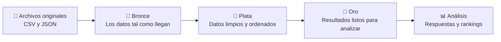

<div align="center">

# 🎬 Movie History

### ¿Qué país gasta más haciendo películas? ¿Cuál gana más con ellas?

*Un viaje de archivos desordenados a respuestas claras sobre el negocio del cine.*


</div>

---

## 🍿 La idea

Detrás de cada película hay mucha información: cuánto costó, cuánto recaudó, quién actuó, en qué idioma se habló, qué compañía la produjo y en qué país se filmó.

El problema es que esa información llega **regada en más de una docena de archivos**, con formatos distintos y nombres poco amigables. Así no se puede responder nada.

**Movie History** toma ese desorden y lo convierte, paso a paso, en tablas listas para hacerle preguntas al cine.

## 🔍 Preguntas que puedes responder

- 💰 ¿Qué países invierten más en producir películas… y cuáles recuperan más dinero?
- 🏢 ¿Qué compañías productoras dominan la taquilla?
- 🎭 ¿Qué géneros mueven más dinero cada año?
- 📈 ¿Cómo ha crecido, año tras año, lo que cada país invierte y gana en cine?
- 🗣️ ¿En qué idiomas se hacen las películas de cada género?

## 🥉🥈🥇 Cómo funciona: tres niveles, como en un podio

Los datos pasan por tres etapas. En cada una salen un poco más limpios y útiles.



| Nivel | ¿Qué pasa aquí? | Una analogía |
|---|---|---|
| 🥉 **Bronce** | Se guardan los archivos tal como llegan, sin tocarlos. | Los ingredientes recién comprados. |
| 🥈 **Plata** | Se limpian: nombres claros, tipos de dato correctos y fecha de llegada. | Los ingredientes lavados y picados. |
| 🥇 **Oro** | Se cruzan películas, países, géneros y compañías, y se calculan totales y rankings. | El plato servido. |

## ✨ Lo que lo hace interesante

- **🔄 Aprende de lo nuevo sin olvidar lo anterior.** Cuando llegan datos nuevos, el proyecto no vuelve a empezar desde cero. Agrega lo nuevo y actualiza lo que cambió, como quien pone al día una libreta en vez de reescribirla completa.
- **🤖 Un botón para todo.** Unos notebooks "director de orquesta" ejecutan los demás en orden. Detectan solos qué archivos y qué fechas hay que procesar.
- **🧩 Piezas reutilizables.** Las tareas que se repiten viven en un solo lugar y todos los notebooks las usan.
- **🏆 Rankings por año.** No solo dice cuánto dinero hubo, también quién quedó primero, segundo y tercero cada año.
- **🔐 Acceso ordenado.** El acceso al almacenamiento en la nube se configura una sola vez, de forma centralizada.

## 🗺️ Recorrido por el proyecto

```
movie_history/
├── 🔐 set-up/                              Conexión con el almacenamiento en la nube
├── 🧰 includes/                            Configuración y funciones compartidas
├── 🧹 utils/                               Reinicio para empezar la carga por lotes
├── 📥 ingestion/                           Carga completa: Bronce → Plata
├── 📥 ingestion_incremental_append/        Carga por lotes: Bronce → Plata
├── ⚙️ transformations/                     Carga completa: Plata → Oro
├── ⚙️ transformations_incremental_append/  Carga por lotes: Plata → Oro
└── 📊 analytics/                           Las preguntas al cine
```

> 💡 Cada notebook empieza con un párrafo que explica qué hace, y sus secciones tienen títulos. Se pueden leer como un libro.

## 🚀 Pruébalo tú mismo

1. **Prepara el terreno.** Ejecuta `set-up/access configure` para conectar Databricks con el almacenamiento en Azure.
2. **Trae los datos.** Corre el notebook `00. Ingestion_all_files` de la carpeta de ingesta que prefieras (completa o por lotes).
3. **Cocina los resultados.** Ejecuta los notebooks de `transformations` (o su versión por lotes).
4. **Pregunta.** Abre la carpeta `analytics` y explora.

> ¿Quieres empezar de cero la carga por lotes? `utils/01. prepare_for_incremental_load` deja todo limpio. ⚠️ Úsalo con cuidado: borra las tablas de Plata y Oro.

## 🛠️ Hecho con

| Herramienta | Para qué se usa |
|---|---|
| **Azure Data Lake Storage** | Guardar los archivos en la nube, separados por nivel |
| **Databricks + Unity Catalog** | Ejecutar los notebooks y organizar las tablas |
| **PySpark y SQL** | Limpiar, cruzar y resumir los datos |
| **Delta Lake** | Tablas que se actualizan sin duplicar y guardan su historial |

## 🌱 Lo que viene

- [ ] Un tablero visual para explorar los resultados sin escribir código
- [ ] Ejecución automática programada cuando lleguen datos nuevos
- [ ] Controles de calidad para detectar datos raros antes de que lleguen a Oro

---

<div align="center">

Hecho con 🎞️ y ☕ por **Luis Alejandro Duque Cardona**

*Ingeniero de datos · Databricks Certified Data Engineer Professional*

⭐ Si este proyecto te pareció curioso, déjale una estrella.

</div>
